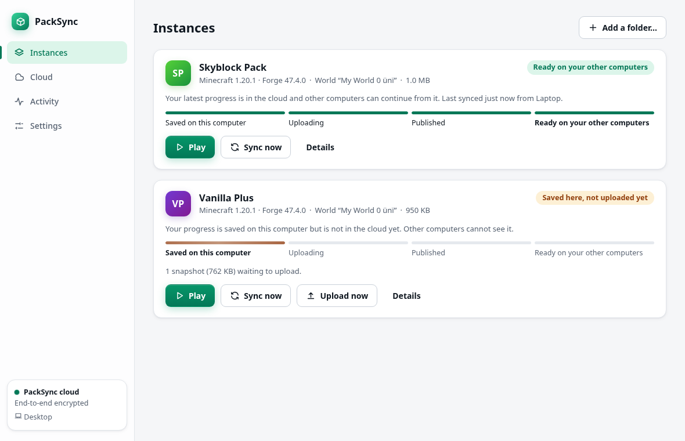
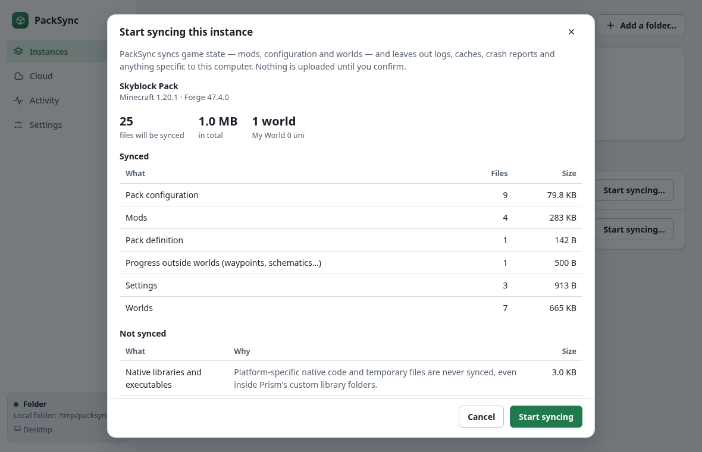
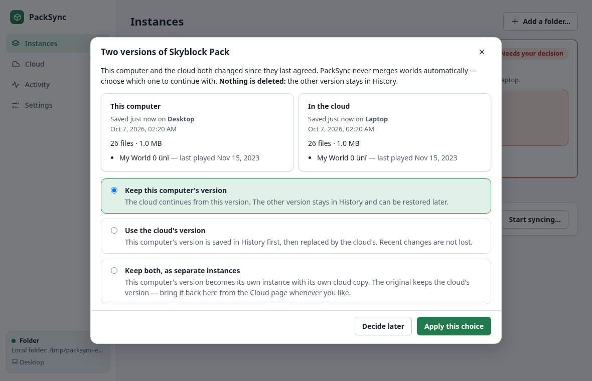
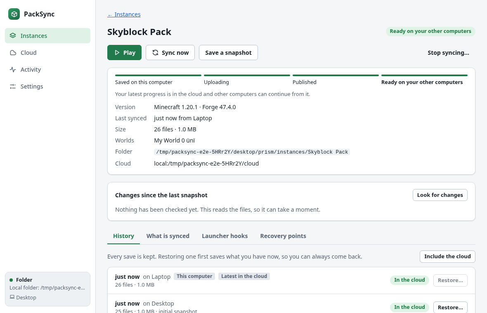
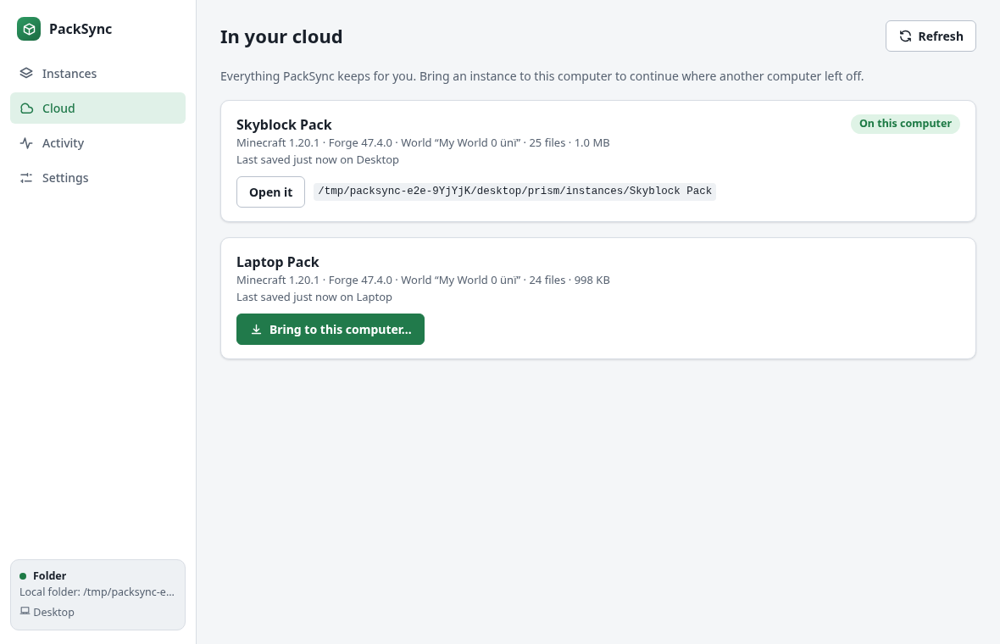

# PackSync

**Continue your Minecraft modpack on any computer.** PackSync keeps a [Prism Launcher](https://prismlauncher.org/)
instance — mods, configuration and single-player worlds — in sync between your computers through **your own
Google Drive**. Stop playing on the desktop, sit down at the laptop, press *Play*, and carry on.



* **Your cloud, your account.** There is no PackSync server and no PackSync account. The app talks to Google
  Drive directly, with a permission you grant in your browser.
* **Fast after the first sync.** Only what changed is uploaded: a few chunks of a region file, not the whole
  world; a renamed mod costs kilobytes (the new manifest), not the jar (`docs/performance.md`).
* **It never merges your worlds.** If two computers changed the same instance, PackSync shows both versions
  and you choose. Nothing is deleted — the other version stays in the history.
* **Crashes are not mistaken for saves.** If the game dies, PackSync keeps what it found as a *crash save*
  and asks you, instead of silently uploading a half-written world.
* **Honest about state.** "Saved here, not uploaded yet" is never shown as "synced". An instance is *ready
  on your other computers* only after the data is in the cloud, verified, and listed.
* **Recoverable.** Every restore first saves what you have and keeps the replaced files for a while.
* **Open source, MIT.** A Rust engine, a command-line tool, and a desktop app (Tauri + React).

> **Status: pre-release, built from source, not published.** Everything below says what has and has not been
> verified. In short: the engine, the CLI and the desktop app are implemented and tested — against Google
> Drive **mocks**, a fake launcher, and (on Linux) the **real Prism Launcher 11.0.3**. It has **not** been
> run against real Google Drive (nobody had credentials to test with), and it has only been built and run on
> Linux. See [Status](#status) and [`docs/testing.md`](docs/testing.md).

## Contents

[What it does](#what-it-does) · [Install](#install--build) · [Quick start](#quick-start) ·
[Connecting Google Drive](#connecting-google-drive) · [Prism integration](#prism-integration) ·
[What is synced](#what-is-synced) · [Guarantees and limits](#guarantees-and-limits) ·
[Conflicts, crashes and recovery](#conflicts-crashes-and-recovery) · [Status](#status) ·
[Platforms](#platforms) · [Development](#development) · [Documentation](#documentation) ·
[Contributing](#contributing) · [Licence](#licence)

## What it does

You have a modpack in Prism Launcher on more than one computer. PackSync makes the *state* of that instance
follow you:

1. **Enable** syncing for an instance. PackSync shows exactly what it would sync and what it would leave out
   (and why), then takes a first snapshot and uploads it.
2. **Play** from PackSync (or from Prism, with optional hooks). Before the game starts PackSync checks the
   cloud and brings in newer progress; when the game closes it saves a snapshot and uploads it.
3. On another computer, **bring the instance over** from the cloud: it is downloaded and verified in a
   hidden folder, then appears in Prism all at once, with this computer's own Java and memory settings.

| | |
|---|---|
|  |  |
| *Preview: what is synced, what is not, and why — before anything is uploaded.* | *Conflict: both versions side by side; PackSync never merges worlds.* |
|  |  |
| *History: every save is kept; restoring keeps a recovery point.* | *Cloud: bring an instance from another computer.* |

The real desktop window (Tauri/WebKitGTK on Linux, dark mode) is in [`docs/images/desktop-app.png`](docs/images/desktop-app.png).
All other pictures are the same UI in a browser against the real engine in the test world
(`apps/desktop/e2e/screenshots.spec.ts`).

## Install / build

There are **no published releases or installers yet**; build from source. You need
[Rust](https://rustup.rs/) 1.89 or newer and, for the desktop app, Node.js 22 or newer.

```sh
git clone <this repository> packsync && cd packsync

# the command-line tool and the engine
cargo build --release -p packsync-cli            # → target/release/packsync

# the desktop app
cd apps/desktop
npm ci
npm run tauri build -- --no-bundle                # → src-tauri/target/release/packsync-desktop
# installers (deb, rpm, AppImage, nsis, msi, dmg) need the platform tools; see docs/desktop.md
```

The desktop build uses the operating system's web view: **Linux** needs `webkit2gtk-4.1`, `gtk3`, `libsoup3`
and `librsvg` (package names vary by distribution; see <https://v2.tauri.app/start/prerequisites/>),
**Windows** needs WebView2 (included in current Windows) and the MSVC build tools, **macOS** needs the Xcode
command-line tools.

Run the desktop app, or use the CLI:

```sh
apps/desktop/src-tauri/target/release/packsync-desktop
target/release/packsync --help
```

## Quick start

### With the desktop app

1. Start PackSync. The first-run wizard asks where your worlds should live: **Google Drive** (see
   [below](#connecting-google-drive)) or a plain **folder** (a NAS, a folder another tool mirrors, or just to
   try it out).
2. Pick an instance. Read the preview, then **Start syncing**.
3. On the second computer: **Cloud → Bring to this computer…**

### With the command line

```sh
packsync storage use-local /mnt/nas/packsync      # or: packsync storage use-google && packsync auth login
packsync instances                                # Prism instances found on this computer
packsync preview "<instance folder>"              # what would be synced — changes nothing
packsync enable  "<instance folder>"              # first snapshot + upload
packsync launch  "My Pack"                        # sync, play, save, upload (or use Prism with hooks)

# on the other computer
packsync cloud                                    # instances stored in the cloud
packsync restore-new "My Pack"                    # bring it here as a new Prism instance
packsync sync "My Pack"                           # day to day
packsync history "My Pack"                        # every snapshot; packsync restore "My Pack" <id>
packsync doctor                                   # checks; secrets are redacted
```

Every command accepts `--json` (one stable JSON document) and has documented exit codes
([`docs/cli.md`](docs/cli.md)), so it can be scripted.

## Connecting Google Drive

PackSync needs an **OAuth client** — the identity Google shows on its consent screen. This repository ships
none (nobody registered one for the project), so you create your own, free, in about ten minutes:
[`docs/oauth-setup.md`](docs/oauth-setup.md) walks through it, including the one step people miss
(**publish the consent screen**, or Google expires your sign-in after seven days).

| | |
|---|---|
| **Permission requested** | `drive.file` (default): PackSync sees only files **it created**, in a visible folder called *PackSync* in My Drive. Or `drive.appdata`: a hidden app folder. Both are *non-sensitive* scopes; no Google verification is needed. |
| **Not requested** | Your other Drive files. PackSync cannot list or read them. |
| **Where the token is kept** | Only the refresh token, only in the operating system's credential store (Windows Credential Manager, macOS Keychain, Secret Service on Linux). **There is no plaintext fallback.** |
| **Sign-in** | System browser (never an embedded web view), PKCE, loopback listener on `127.0.0.1`. |
| **Disconnecting** | Forgets the token on this computer, optionally revokes it at Google. Never deletes cloud data. |

**Not verified live:** the whole Google Drive path is tested against a faithful mock server (OAuth flow,
resumable uploads, retries, revocation, duplicate names, secret hygiene…), but **never against real Google**.
In particular, that files created on one computer stay visible to the same client on another under
`drive.file` is Google's documented behaviour but unconfirmed here. [`docs/live-validation.md`](docs/live-validation.md)
describes a short procedure — and a self-test binary — to confirm it for yourself with a throwaway folder
before you trust it with a world.

**Privacy:** PackSync does not encrypt your files (end-to-end encryption is not part of v1, and it will not
invent its own cryptography). They sit unencrypted in your Drive, protected by your Google account. Worlds can
contain player names and coordinates. [`docs/threat-model.md`](docs/threat-model.md) says what is and is not
protected.

## Prism integration

* **Discovery.** PackSync finds Prism instances in the usual places (including the Flatpak) and lets you pick
  any folder by hand. Prism's account file and settings live outside the instances and are never touched; if
  a folder that contains them is ever selected, a sealed rule excludes them (and key files, `.env`…) no matter
  what other rules say.
* **Play.** The *Play* button (and `packsync launch`) syncs first, starts Prism itself, tracks the game
  process, and saves and uploads when the game closes.
* **Optional hooks.** If you prefer to start instances from Prism, install PackSync's pre-launch and
  post-exit commands for that instance. Installation is previewed, additive (your own commands are chained,
  not replaced), reversible byte for byte, and refuses while Prism is running
  ([`docs/hooks.md`](docs/hooks.md)).
* **Restoring.** A restored instance is built in a hidden folder, verified, and renamed into Prism's
  instances folder in one step, so Prism never sees a half-written instance.

All of this was verified against the **real Prism Launcher 11.0.3 on Linux** (`scripts/prism-smoke.sh`,
20 checks: hook semantics, quoting, forwarding to a running Prism, install → launch → uninstall, the crash
flow, a restored instance launching, `packsync launch` through the real launcher). It ran in a disposable
sandbox with a fake account and a stand-in for Java; Minecraft itself did not run
([`docs/dev/prism-verification.md`](docs/dev/prism-verification.md)).

## What is synced

*Game state*, not everything in the folder: mods, pack configuration, scripts, resource and data packs,
single-player worlds, waypoints and similar progress, `servers.dat`, the portable part of `options.txt` and
`instance.cfg`, and the pack definition (`mmc-pack.json`, patches). **Not** synced: logs, crash reports,
caches, screenshots, shader packs, native libraries, launcher-managed folders, and anything specific to one
computer (Java path, memory, window state, GPU tuning). Secrets are never synced, whatever the rules say.

The preview tells you the reason for every exclusion, and you can add rules
([`docs/rules.md`](docs/rules.md), [`examples/rules-extra.toml`](examples/rules-extra.toml)).

## Guarantees and limits

What PackSync promises — each point has tests ([`docs/consistency.md`](docs/consistency.md)):

* **No silent data loss.** Cloud data is immutable and content-addressed; nothing is overwritten, and there
  is no mutable "latest" pointer that two computers can fight over. Cleanup is manual, previewed, and only
  touches objects PackSync created.
* **No automatic merging of worlds**, ever.
* **A crash is not a clean exit.** Unclean sessions are quarantined and need a decision.
* **Restores are recoverable, not atomic** (no file system makes a directory swap atomic): every restore is
  journaled, and after any interruption — tested by killing the real process at every boundary — the next run
  either rolls back to what you had or completes it.
* **Never "missing means deleted".** An unreadable folder, an unplugged drive or an empty cloud is
  *unknown*, not *deleted*. Mass deletions need your confirmation.
* **Untrusted cloud data.** Everything read from the cloud is bounded and validated before use; paths cannot
  escape the instance; symlinks are never followed.

What it does **not** do:

* It is built for **one person on several computers** — not for sharing an instance between people.
* It cannot stop two computers being played at the same time. It warns when another computer looks active
  (an advisory note, not a lock) and turns the divergence into a conflict you resolve.
* It does not encrypt, and it cannot tell a legitimate mod update from a malicious one: a mod is a program.
  Treat the cloud folder with the care you give your mods folder.
* Google Drive listings are only eventually consistent, so a freshly uploaded snapshot can take a moment to
  be *visible* to another computer (the app says "published" until it is).
* Cleanup frees space per pack object; partly-used packs are reported, not repacked.

## Conflicts, crashes and recovery

* **Offline.** The game starts from the local copy (or, if you prefer, refuses — a setting); everything is
  saved locally and uploaded later. Failed uploads retry with backoff, resume where they stopped, and never
  create a visible half-snapshot.
* **Conflict.** *Keep this computer's version*, *use the cloud's version*, or *keep both as separate
  instances*. Both versions remain in the history.
* **Crash save.** *Keep it* (continue from what is on disk) or *go back* to the last good save.
* **Restore.** Pick any snapshot in the history; a preview shows what changes; your current state is saved first.
  The replaced files stay in **Recovery points** for a while.
* **Something looks wrong?** `packsync verify --remote` checks the cloud; `packsync doctor --out report.txt`
  writes a redacted report for a bug report.

## Status

| | |
|---|---|
| **Implemented** | Sync engine (scan, chunking, packs, manifests, upload, reconcile, journaled restore, recovery, sessions, conflicts, crash quarantine, retention/cleanup); Google Drive adapter + OAuth; Prism adapter + hooks; command-line tool; desktop app (setup, instances, history/restore, conflicts, crashes, hooks, cloud, settings, cleanup). |
| **Tested locally** (no credentials) | 365 Rust tests (unit, journeys on two simulated computers, crash/kill at every boundary, network faults, hostile data, concurrency, the Drive adapter and OAuth against a mock server, the Prism adapter, the CLI as a real process), 122 UI unit/component tests, 38 browser tests that drive the real UI against the real engine, accessibility checks (axe, light and dark). |
| **Tested against a real service** | **Prism Launcher 11.0.3 on Linux** (sandboxed). The desktop shell was started and driven on Linux (WebKitGTK). |
| **Not tested against real services** | **Google Drive and Google OAuth**; the OS credential store on this machine; **Windows and macOS** (CI workflows are written, nothing has ever run on them); a GUI Prism noticing a restored instance. |
| **Not done** | End-to-end encryption; deleting history (v1 releases the *content* of old snapshots but keeps their manifests); signed installers and releases; auto-update; other launchers (the adapter interface is there). |

Details, numbers and the bugs the tests found: [`docs/testing.md`](docs/testing.md).

## Platforms

| | Engine and CLI | Desktop app | Prism adapter | Verified |
|---|---|---|---|---|
| **Linux** (x86_64) | ✔ | ✔ | ✔ (native and Flatpak paths) | built, tested and run here |
| **Windows** | designed for it (long paths, reserved names, case folding, per-OS process detection) | Tauri supports it | designed for it | **not built or run** |
| **macOS** | architecture-compatible | Tauri supports it | designed for it | **not built or run** |

## Development

```sh
cargo fmt --all --check
cargo clippy --workspace --all-targets -- -D warnings
cargo test --workspace                                   # no credentials, Prism or network needed
cargo test -p packsync-cli --features failpoints         # real process kills at every boundary

cd apps/desktop
npm ci
npm run typecheck && npm run lint && npm test            # UI unit and component tests
npm run build
npx playwright install chromium
npm run e2e                                              # the real UI against the real engine (builds the test world)
```

Benchmarks (`docs/performance.md`) and the real-Prism smoke test (`scripts/prism-smoke.sh`, Linux, needs a
Prism AppImage) are separate and documented in [`docs/testing.md`](docs/testing.md). Real Google Drive tests
need a designated test account and are **never** run by default or in CI ([`docs/live-validation.md`](docs/live-validation.md)).

### Layout

```
crates/packsync-core    the engine: scan, chunking, packs, snapshots, upload, reconcile, restore, recovery, GC
crates/packsync-drive   Google Drive adapter, OAuth, keyring, and a mock Drive server for tests
crates/packsync-prism   Prism adapter: discovery, registration, launching, hooks, Qt INI/command-line ports
crates/packsync-app     the application layer: settings, jobs, launch orchestration, JSON API (what the UI calls)
crates/packsync-cli     the `packsync` command
crates/packsync-bench   reproducible benchmarks
crates/packsync-e2e     test support: a disposable two-computer world for the browser tests
apps/desktop            React/TypeScript UI, Playwright and Vitest tests
apps/desktop/src-tauri  the Tauri shell (its own Cargo workspace)
docs/                   architecture, formats, consistency, threat model, CLI, rules, hooks, performance, testing
examples/               sample settings and rules
```

## Documentation

[Architecture](docs/architecture.md) · [Remote format](docs/remote-format.md) ·
[Consistency model](docs/consistency.md) · [State machines](docs/state-machine.md) ·
[Threat model](docs/threat-model.md) · [CLI](docs/cli.md) · [Rules](docs/rules.md) ·
[Launcher hooks](docs/hooks.md) · [Google OAuth setup](docs/oauth-setup.md) ·
[Live validation](docs/live-validation.md) · [Desktop app](docs/desktop.md) ·
[Performance](docs/performance.md) · [Testing and status](docs/testing.md) ·
[Dependencies](docs/dependencies.md) · [Rebranding](docs/rebranding.md)

## Contributing

Please read [`CONTRIBUTING.md`](CONTRIBUTING.md). Security reports: [`SECURITY.md`](SECURITY.md).
Never put credentials, access tokens, downloaded mod JARs, Minecraft files or real world data in an issue,
a test fixture or a commit — fixtures here are generated.

## Licence

[MIT](LICENSE). PackSync is not affiliated with or endorsed by Mojang, Microsoft, Prism Launcher or Google.
"Minecraft" is a trademark of Mojang Synergies AB; "Google Drive" of Google LLC.
