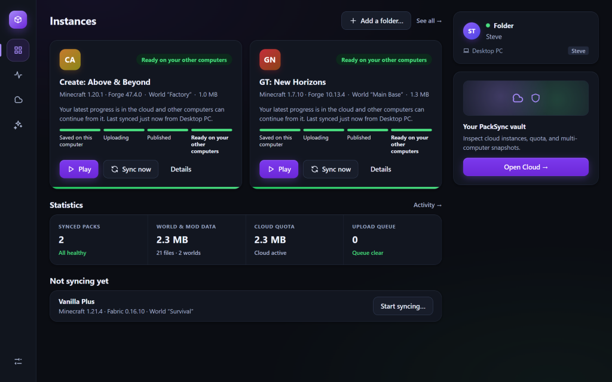

# PackSync

Sync your [Prism Launcher](https://prismlauncher.org/) Minecraft modpacks across computers — mods, configs, and single-player worlds stay in sync automatically.



## Features

- **Play anywhere:** Sign in with your Minecraft (Microsoft) account on each PC to sync the same instances automatically.
- **Fast delta uploads:** Only changed file blocks are compressed and uploaded, so typical play sessions sync in seconds.
- **Prism Launcher hooks:** Optional pre-launch and post-exit hooks pull updates when you hit Play and upload changes when you close the game.
- **Safe worlds:** Worlds are never merged automatically. If two PCs diverge, you choose which version to keep while the other remains recoverable in history.
- **Crash protection:** Saves from an abnormal game exit are held back for review instead of overwriting good cloud snapshots.
- **Flexible storage:** Use the built-in encrypted PackSync Cloud, or connect your own Google Drive, Cloudflare R2 bucket, or synced folder.
- **Local log export:** View recent sync operations, inspect redacted logs on demand, export them as JSON, or clear them anytime.

## Installation

Download the latest build from [Releases](https://github.com/calvintugman/packsync/releases):

- **Windows:** Extract the `.zip` into a permanent folder and run `packsync-desktop.exe`. *(Builds are currently unsigned, so Windows SmartScreen will show a warning on first launch.)*
- **Linux:** Extract the `.tar.gz` and run `./install.sh`, or install the `.deb` package. Requires WebKitGTK 4.1 (`libwebkit2gtk-4.1-0` on Debian/Ubuntu, `webkit2gtk-4.1` on Arch).

## Getting Started

1. Open PackSync and choose **Sign in with Minecraft** (or switch to **Google Drive**, **Synced Folder**, or **Cloudflare R2**).
2. Pick the Prism Launcher instances you want to sync.
3. Install PackSync on your other computer and sign in with the same account to pull your instances down and keep playing.

## Storage & Privacy

- **PackSync Cloud** encrypts your files locally (`XChaCha20-Poly1305`) before upload and runs on Cloudflare Workers, R2, and D1. Default limits are 5 GiB per account, 10,000 objects, and daily operation caps, with automatic cleanup for abandoned accounts. You can delete your cloud account and all stored data anytime from **Settings** or `packsync storage delete-account`.
- See [PRIVACY.md](PRIVACY.md) for what the hosted service stores and [SECURITY.md](SECURITY.md) for vulnerability reporting.

## Building from Source

Requires **Rust 1.89+** and **Node.js 22+**:

```sh
# CLI
cargo build --release -p packsync-cli

# Desktop app
cd apps/desktop
npm ci
npm run tauri build -- --no-bundle
```

## Architecture

- **Engine (`crates/packsync-core`):** Rust sync engine using content-defined and fixed-size chunking, zstd compression, BLAKE3 content addressing, journaled crash-safe restores, and SQLite state. Backends implement two traits (`Storage` and `Launcher`).
- **Desktop & CLI (`apps/desktop`, `crates/packsync-cli`):** Tauri 2 + React desktop app and `packsync` CLI sharing one application layer (`crates/packsync-app`).
- **Hosted Service (`services/hosted`):** Cloudflare Worker with R2 + D1, Microsoft OAuth 2.0 device-code sign-in, per-device hashed sessions, and scheduled cleanup.

## License

MIT — see [LICENSE](LICENSE). For contributing guidelines and release history, see [CONTRIBUTING.md](CONTRIBUTING.md) and [CHANGELOG.md](CHANGELOG.md).
