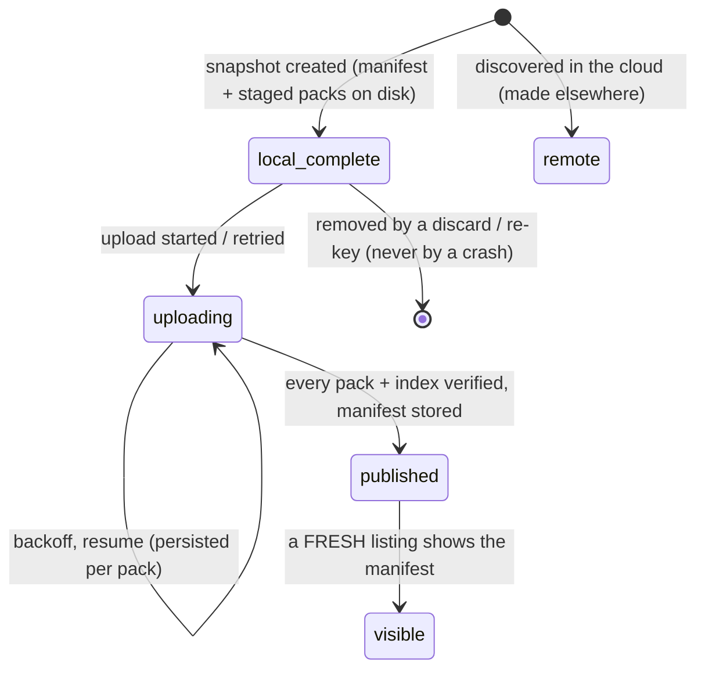
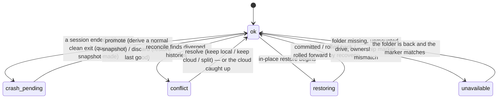
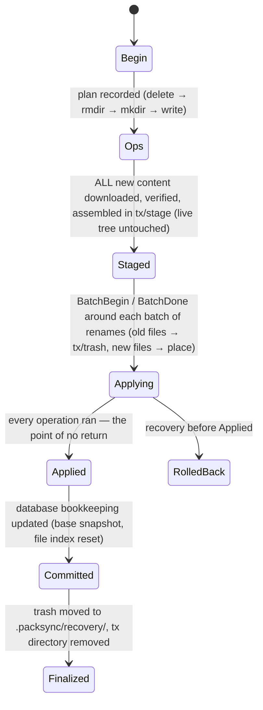
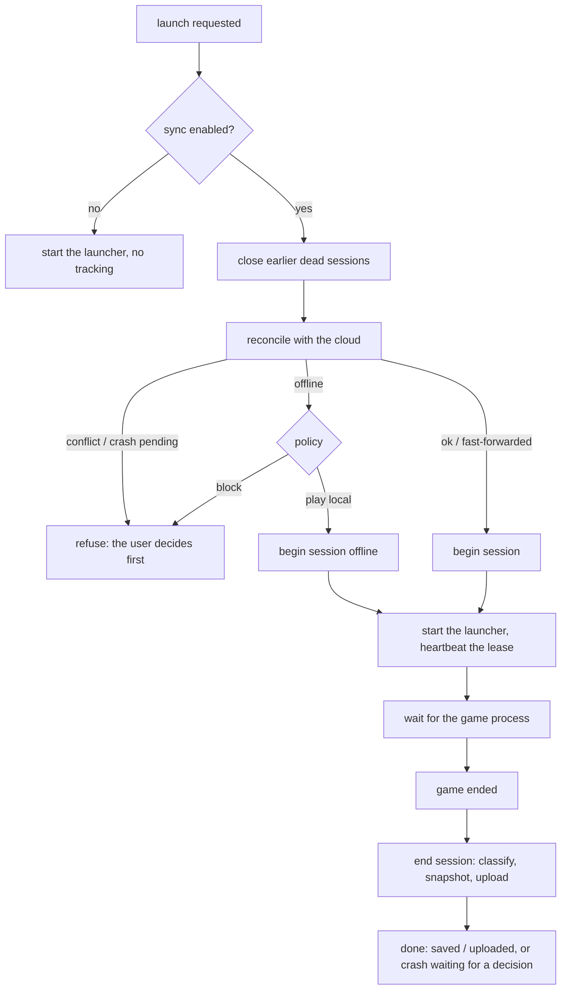

# State machines

Four small state machines drive everything. They are implemented in `crates/packsync-core` (the code
paths named below) and tested by the suites in `docs/testing.md`. Diagrams are Mermaid (rendered by GitHub).

## 1. Snapshot lifecycle (per snapshot, per computer)



* `local_complete → uploading → published` is `upload.rs` (`Uploader::publish`): packs first, then the
  index, then a verification pass (every pack exists with the recorded size), the manifest **last**, then
  the device's head record.
* `published → visible` is deliberately separate: "ready on your other computers" is only claimed after
  `discover` (a fresh listing of `commits/`) contains the snapshot, because Drive listings may lag.
* The UI/CLI wording follows these states: *saved on this computer — not uploaded yet* (`local_complete`),
  *upload pending* (`uploading`), *uploaded and verified — not yet visible* (`published`), *up to date —
  ready on your other computers* (`visible`).

## 2. Instance state (per instance, per computer)



Guards (`Engine::require_state`): `snapshot`/`reconcile` run in `ok`, `conflict` and (snapshot only)
`crash_pending`; `begin_session` and `restore_snapshot` only in `ok`; `resolve_conflict` in `conflict`/`ok`;
`promote_crash`/`discard_crash` only in `crash_pending`. Anything else fails with an error that says what
to do. Every operation additionally takes the per-instance OS file lock and refuses while a game or
another recognised writer is active.

### Sync phase (what the user sees)

A pure function of: instance state, whether the base snapshot is published/visible, pending uploads and the
cloud's heads. `not_enabled`, `local_snapshot_complete`, `upload_pending`, `cloud_published`,
`ready_on_other_devices`, `cloud_ahead`, `conflict`, `crash_pending`, `restoring`, `unavailable`
(`engine/instances.rs::status`).

## 3. Play session

```mermaid
stateDiagram-v2
    [*] --> starting: begin_session (token; base snapshot recorded; open-session unique per token)
    starting --> running: game process found (pid + start time recorded)
    running --> ended_clean: end_session, exit 0 / clean signal / post-exit hook
    running --> ended_crashed: end_session, non-zero exit or crash report / hs_err since start
    starting --> ended_clean: the game never started (launcher failed) — nothing changed
    running --> interrupted: no end signal, game gone (killed, power loss) and the grace rules say so
    ended_crashed --> [*]: quarantined snapshot, instance → crash_pending
    interrupted --> [*]: quarantined snapshot, instance → crash_pending
```

* **Who closes a session.** The component that started it: PackSync's `launch` (it tracks the game
  process), or the launcher hooks (pre-launch begins, post-exit ends). If the app owns the session, hooks
  stand aside — except that the post-exit hook leaves a *clean-exit signal* the app collects. An app that
  was killed no longer owns its session (its pid is recorded), so the hooks take over.
* **Crash vs "just exited".** Prism runs the post-exit command only after exit code 0 (verified). A session
  that is open with no live game is *interrupted* — but a passive observer (an app start, a hook's own
  start-up) waits a 10-minute grace period (or sees that the computer restarted since the session began)
  before declaring that, because the game may have exited a moment ago and the post-exit hook may be
  about to end the session cleanly. A new launch closes earlier dead sessions at once.
* **What a crash does.** The end-of-session snapshot is kept apart (`kind: crash`), uploaded, never a head.
  The instance becomes `crash_pending` and refuses to sync or launch until the user decides.

## 4. Restore transaction (in-place)

Journal records (`journal.rs`), written to `<instance>/.packsync/tx/<tx>/journal.jsonl` with `fsync`:



Recovery (`Engine::recover`, on every start and before every launch) decides per transaction directory:

| Journal ends at | Recovery |
|---|---|
| no journal / `Begin`…`Staged` | nothing touched the live tree: remove the directory |
| inside `Applying` | **roll back**: undo the completed operations (placed files moved back to stage, trash restored), idempotently |
| `Applied` / `Committed` | **roll forward**: finish bookkeeping; if the restore was one the user asked for, also record it as a new snapshot so it sticks |
| `Finalized` / `RolledBack` | remove the leftover directory |

Every record boundary is a failpoint; `tests/crash.rs` kills at each one (in process) and
`tests/killed.rs` (CLI) aborts a real process at each one, then checks that the instance is exactly the
old or the new version, never a mix, and that a fresh restore converges. Recovery itself can crash and be
repeated (`recovery_itself_can_crash_and_be_repeated`).

New-instance restores (`restore_new`) are simpler: everything is built in a hidden `.packsync-restore-*`
folder next to the final location, which the launcher ignores; an ownership marker and a database record
identify it as PackSync's, so a crash leaves nothing that could be mistaken for an instance and the next
start removes it. Only when complete and verified is it renamed into place and registered.

## 5. Launch (application level)


